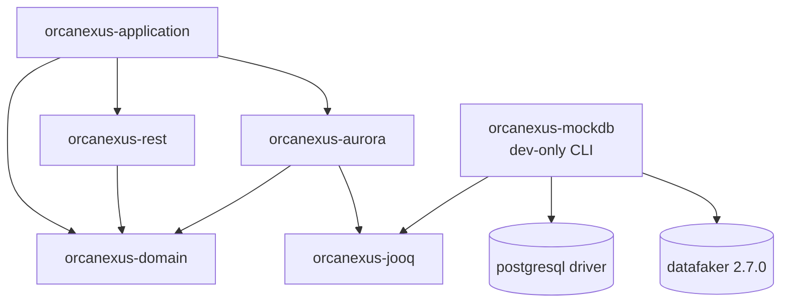
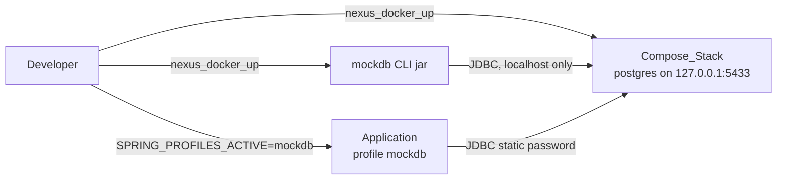
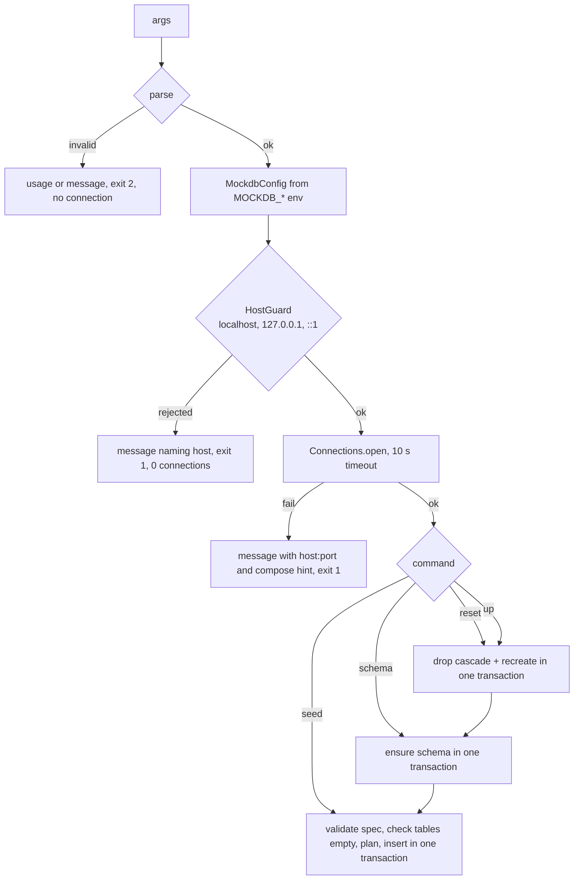
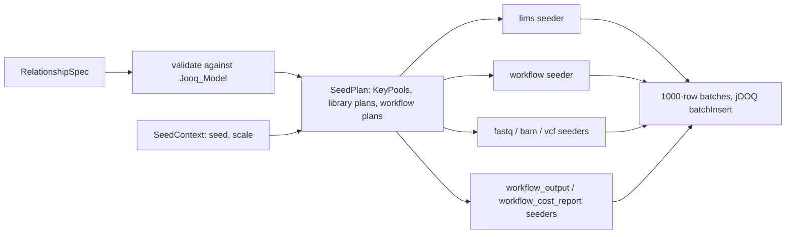

# Design Document

## Overview

Add an offline development path to OrcaNexus: a local PostgreSQL in Docker Compose,
filled with deterministic synthetic data, selected through the Spring profile `mockdb`. The
remote dev path stays available. The default profile is renamed from `local` to
`tunnel` so that each profile is named after how it reaches its data.

Three deliverables:

1. **`orcanexus-mockdb`**, a dev-only Maven module with a small CLI (`schema`, `seed`, `reset`,
   `up`). It builds DDL from the committed jOOQ model and seeds synthetic rows with Datafaker.
2. **Configuration**: a Compose file, `application-mockdb.yaml`, and the rename
   `application-local.yaml` to `application-tunnel.yaml`.
3. **Tooling and docs**: three `dx.sh` helpers, an ADR that supersedes 0005, a `docs/dev`
   recipe, and short steering updates.

Design principles:

- **The runtime is untouched.** No Java in `domain`, `rest`, `aurora` or `application` changes.
  The application only gains one profile file and one tiny SQL check resource.
- **The model drives everything.** Table names, column names, types and nullability are read from
  the jOOQ model at run time. Only the *relationships* between columns are written by hand
  (the Relationship_Spec), because the model has no keys.
- **Determinism by construction.** Every random choice derives from one Seed_Value. Nothing reads
  the wall clock, `UUID.randomUUID()` or hash-ordered collections.
- **Framework configuration over custom properties** ([ADR 0007](../../../docs/adr/0007-prefer-framework-configuration.md)).
  No new `orcanexus.*` property is added.

Out of scope: real warehouse data, Testcontainers, CI use of the Compose_Stack, write endpoints,
and any change to the remote path other than the profile rename.

## Research and Verified Facts

| Topic | Finding | Source |
|-------|---------|--------|
| Datafaker version | 2.7.0 is the latest release in the Maven Central metadata (`2.6.0` precedes it). Java 17+ is required. Its pom takes `snakeyaml`, `rgxgen` and `libphonenumber`. Boot's BOM manages `snakeyaml` (2.6) and `commons-lang3`; the pin of Datafaker itself is ours. | [Maven Central metadata](https://repo1.maven.org/maven2/net/datafaker/datafaker/maven-metadata.xml), [Datafaker docs](https://www.datafaker.net/documentation/getting-started/) |
| PostgreSQL driver | Boot 4.1.1 manages `org.postgresql:postgresql` at 42.7.13 (already in `~/.m2`). The module declares it without a version. | `spring-boot-dependencies-4.1.1.pom` |
| jOOQ version | 3.21.7, managed by Boot. `DDLExportConfiguration` exposes `createSchemaIfNotExists`, `createTableIfNotExists`, `flags(...)` and `inlinePrimaryKeyConstraints`. | jOOQ 3.21.7 sources in `~/.m2` |
| Real column types | Besides `text`, `date`, `timestamp(6)` and `bigint`, there is `NUMERIC(12,4)` in `workflow.workflow_duration`, and `NUMERIC(18,2)` only in `workflow_cost_report` (three columns). Boundary logic reads precision and scale from the model per column, so both are handled without special cases. | `orcanexus-jooq/.../tables/*.java` |
| Model schema name | The generated schema is `mart`; the physical dev schema differs (see `jooq.md`). On the local database the physical and generated names are the same, so no rewrite is needed. The tool never hardcodes the name; it reads it from the model (`Mart.MART.getName()`). | `orcanexus-jooq/pom.xml`, `jooq.md` |
| Test stack | JUnit 5 and AssertJ via Spring Boot starters, Mockito in `rest`. No jqwik or other PBT library. | module POMs, existing tests |
| Static analysis | Checkstyle has only three rules (`AvoidStarImport`, `UnusedImports`, `FinalClass`). SpotBugs runs at effort Max, threshold Default; the exclude filter only skips generated jOOQ code. Spotless runs google-java-format everywhere except `orcanexus-jooq`. | `config/`, root `pom.xml` |
| PostgreSQL 18 image data path | From 18, the official image uses a versioned `PGDATA` (for example `/var/lib/postgresql/18/docker`), so the volume is mounted at `/var/lib/postgresql`. Mounting `/var/lib/postgresql/data` silently creates an anonymous volume and loses data on recreate. Reported consistently by several sources; verified by the restart checks in task 1.1. | Docker Hub `postgres` image notes and community reports. Verified in task 1.1: stop/start and down/up (no `-v`) keep the rows, one named volume exists and no anonymous volume was created. |
| Compose healthcheck gotcha | The official image starts a temporary server on the Unix socket only during first-time init. `pg_isready` over the socket can report ready too early; checking over TCP (`-h 127.0.0.1`) avoids it. | PostgreSQL image entrypoint behaviour. The TCP check was used in task 1.1 and the container became healthy. |
| Spring property precedence | Profile documents override base `application.yaml` per key. Placeholders are resolved lazily for the winning value only. See [Profile Resolution](#profile-resolution-and-the-unresolved-placeholders). | Spring Boot reference, reasoned; confirmed at runtime in verification step V3 |
| Compose project directory | With `-f orcanexus-mockdb/compose.yaml`, Compose reads `.env` from that file's directory, not the repository root. The repository `.env` is therefore not loaded by the Compose_Stack. | Compose behaviour. Task 1.1: every variable resolved to its default, which is consistent with this. It is not provable without reading the repository `.env`, which was not read. |
| Compose volume name | Compose prefixes the project name, so the actual volume is `orcanexus-mockdb_orcanexus-mockdb-data`, not the bare `orcanexus-mockdb-data`. | Task 1.1 (`docker volume ls`) |
| Task 1 outcomes | `postgres:18.6` exists and pulls (PostgreSQL 18.6, Debian 18.6-1.pgdg13+2). The Boot-repackaged jar runs with Datafaker 2.7.0, postgresql 42.7.13, jOOQ 3.21.7 and snakeyaml 2.6, with no version conflict. `spring.sql.init` with `select 1` works on Boot 4.1.1. No fallback was needed. | Tasks 1.1 to 1.4 |

## Architecture

### Module and dependency diagram

`orcanexus-mockdb` is a leaf next to the hexagon. Nothing depends on it.



Arrows point from dependent to dependency. `mockdb` is listed last in the parent `modules`
so the reactor order keeps it out of the way. It declares no dependency on `domain`, `rest`,
`aurora` or `application`, and none of those declares one on it (Requirement 3.2, 3.3).

### Runtime topology



The tool and the application read separate variables (`MOCKDB_*`). The tunnel variables
(`DB_*`) are never read by either on the mockdb path.

### Command flow



`up` runs `reset`, `schema`, `seed` as three steps, each in its own transaction. A failure names
the step and stops (Requirement 9.2, 9.3). `reset` already recreates the empty tables, so the
`schema` step after it is a no-op; it stays because Requirement 9.2 defines `up` that way and
it costs nothing.

### Seeding flow



## Components and Interfaces

### 1. Module `orcanexus-mockdb`

**POM (exact versions, no ranges):**

- Parent `dev.ccgcm.platform:orcanexus:1.0-SNAPSHOT`, packaging `jar`, artifact `orcanexus-mockdb`.
- Property `datafaker.version` = `2.7.0`.
- Dependencies: `orcanexus-jooq:1.0-SNAPSHOT`; `org.postgresql:postgresql` (Boot-managed 42.7.13,
  compile scope so the CLI jar carries it); `net.datafaker:datafaker:${datafaker.version}`;
  test scope: `org.junit.jupiter:junit-jupiter` and `org.assertj:assertj-core` (both
  Boot-managed). No Spring starter, no `domain`, `rest`, `aurora`, `application`.
- Parent `modules`: add `<module>orcanexus-mockdb</module>` after `orcanexus-domain`.

**How the CLI runs: a Spring Boot repackaged executable jar.** The module declares
`spring-boot-maven-plugin` (version managed by the parent) with `<mainClass>` set to
`dev.ccgcm.platform.orcanexus.mockdb.MockdbMain`. `mvn -DskipTests package` then produces
`orcanexus-mockdb/target/orcanexus-mockdb-1.0-SNAPSHOT.jar`, which runs with
`java -jar ... <subcommand> [options]`. `dx.sh` wraps exactly that.

| Option | Why not chosen |
|--------|----------------|
| `exec-maven-plugin` `exec:java` | In a reactor build with `-am`, the goal also runs in `orcanexus-jooq` and fails; without `-am` it needs `orcanexus-jooq` installed in `~/.m2`. Both are awkward for a `dx.sh` wrapper. |
| `maven-shade-plugin` | Works, but needs transformers to merge `META-INF/services` and signature handling. Was the fallback if Datafaker resource loading failed inside the Boot nested-jar loader; task 1.3 showed it works, so shade is not needed. |
| Plain jar plus classpath file | Two steps and a classpath file to keep in sync. |

Repackaging replaces the module's own main artifact. That is fine because nothing depends on
it. The PostgreSQL driver is registered explicitly with `Class.forName("org.postgresql.Driver")`
in `Connections`, because `DriverManager` service discovery can miss drivers in nested jars.

**Package layout** under `dev.ccgcm.platform.orcanexus.mockdb`:

| Package / class | Responsibility |
|-----------------|----------------|
| `MockdbMain` | `main`: wires real env and `Output`, calls `MockdbCli.run`, passes the returned code to `System.exit`. The only place that exits. |
| `cli.MockdbCli` | `int run(String[] args, Map<String,String> env, Output out, Connector connector)`. Orchestrates parse, config, guard, connect, command. |
| `cli.ArgParser` | Pure parser: `Invocation parse(String[] args)`. Throws `UsageException(message, showUsage)`. |
| `cli.Invocation` | Record: `Command command`, `int scale`, `int seed`. Defaults 100 and 42. |
| `cli.Command` | Enum `SCHEMA, SEED, RESET, UP`. Knows whether it accepts `--scale` and `--seed`. |
| `cli.Output` | Two-method interface (`out(String)`, `err(String)`). Keeps `System.out` out of the logic and avoids `EI_EXPOSE_REP2` on a stored `PrintStream`. |
| `config.MockdbConfig` | Record `(host, port, database, user, password)`. `static MockdbConfig fromEnv(Map<String,String>)` reads only `MOCKDB_*`, applies defaults. `toString` omits the password. |
| `config.HostGuard` | `static void require(String host)` throws `HostRejectedException` unless the host is exactly `localhost`, `127.0.0.1` or `::1`. |
| `db.Connector` | Interface `Connection open(MockdbConfig)`. The real one is `Connections`; tests pass a recording fake. |
| `db.Connections` | Registers the driver, builds the JDBC URL (brackets for `::1`), sets `connectTimeout=10`, `loginTimeout=10`, `reWriteBatchedInserts=true`, `ApplicationName=orcanexus-mockdb`. Maps `08001`/`08006` to the "unreachable, start the Compose_Stack" message and `28P01` to a credentials message. |
| `db.SchemaService` | `ensureSchema(DSLContext)`, `reset(DSLContext)`, `ddlQueries()`. Details in the DDL section. |
| `seed.SeedContext` | `(int scale, int seed)` plus `Random stream(String name)` and `Faker faker(Random)`. Derives per-stream seeds with a SplitMix64 mix of the Seed_Value and the stream name. |
| `seed.KeyPools` | Immutable pools of identifiers (below). |
| `seed.Pool` | Enum of pool names: `SUBJECT, SAMPLE, LIBRARY, SEQUENCING_RUN, PORTAL_RUN, COHORT, BUCKET`. |
| `seed.RelationshipSpec` | Table to column to `Pool` map plus `validate(Schema)`. |
| `seed.SeedPlan` | Built once per run from `SeedContext` and `KeyPools`: library plans, workflow plans, row counts per table. |
| `seed.TableSeeder` | Interface: `String table()`, `int rowCount(SeedPlan)`, `Iterator<TableRecord<?>> rows(SeedPlan, SeedContext)`. One class per known table, plus `GenericSeeder`. |
| `seed.NullPlan`, `seed.Boundaries` | Shared helpers for the null policy and boundary rows. |
| `seed.SeedRunner` | Validates the spec, checks emptiness, drives seeders, batches inserts, returns `Map<String,Integer>` row counts and a list of `SeedNote`s (skips, warnings). |
| `seed.SeedNote` | Record for "boundary skipped" and "table has no spec entry" messages. |

No CLI framework (Requirement 4.2). About 25 classes, most under 100 lines. Records holding lists
copy them with `List.copyOf` to stay clean under `EI_EXPOSE_REP`.

**Exit codes:** 0 success or `--help`; 2 usage error (unknown subcommand, bad option, no
subcommand); 1 runtime failure (guard, connection, DDL, seed). All non-zero cases satisfy
Requirements 4.3 to 4.7.

### 2. DDL: schema, idempotence, reset

`SchemaService` builds queries from the model with jOOQ, never from hand-written SQL:

```java
var cfg = new DDLExportConfiguration()
    .flags(DDLFlag.SCHEMA, DDLFlag.TABLE)
    .createSchemaIfNotExists(true)
    .createTableIfNotExists(true)
    .inlinePrimaryKeyConstraints(true);
Queries ddl = dsl.ddl(Mart.MART, cfg);   // dsl dialect must be SQLDialect.POSTGRES
```

- **Verified fact:** `ddl()` emits no `IF NOT EXISTS` by default; the two flags add it.
  All columns are nullable and the model has no keys, so there is no `ALTER` today. Limiting
  `flags` to `SCHEMA` and `TABLE` (no `FOREIGN_KEY`, `INDEX`, ...) keeps the output free of
  `ALTER`, `CREATE INDEX` and sequences if keys are ever added to the model, which protects
  Requirement 5.4 and 5.10.
- **Idempotence (5.4, 5.5, 5.10):** every statement is `create ... if not exists`. Existing
  tables and rows are untouched; missing tables are created. No catalog pre-check is made.
- **Transactionality (5.6):** `dsl.transaction(...)` wraps the whole loop. PostgreSQL DDL is
  transactional, so a rejected statement rolls everything back and leaves no partial schema.
- **Error reporting (5.6):** the loop iterates `Query` objects. On `DataAccessException` it
  prints `query.getSQL(ParamType.INLINED)` and the database message to stderr, then returns 1.
  Iterating `Query` objects (not strings) also keeps SpotBugs'
  `SQL_NONCONSTANT_STRING_PASSED_TO_EXECUTE` quiet.
- **Reset (9.1):** one transaction: `dsl.dropSchemaIfExists(Mart.MART).cascade()`, then the same
  DDL queries. A failure keeps the previous schema, because the drop rolls back. Only the model's
  schema is dropped, never other schemas in the database.
- **Model changes (5.8):** a new or removed relation or column changes `Mart.MART` and therefore
  the DDL with no tool change. `GenericSeeder` covers new tables and new columns.
- **Fidelity (5.9):** tested two ways. DB-free: render the DDL, interpret it with jOOQ's DDL
  interpreter (`dsl.meta(String...)`), and compare name, type, length, precision, scale and
  nullability per column with the model. DB-backed: the same comparison against
  `information_schema` through `dsl.meta()` on a live connection.
- **Open point resolution (DDL execution, verified in task 1.1).** The jOOQ DDL with the flags
  above was accepted by PostgreSQL 18.6, executed twice in one transaction. Output: `create schema
  if not exists "mart"` plus seven `create table if not exists "mart"."<t>"`, with no `ALTER`,
  index or sequence. Types: text, bigint, date, timestamp(6), `numeric(12,4)`
  (`workflow.workflow_duration`) and `numeric(18,2)` (three `workflow_cost_report` columns); all
  columns nullable. No fallback was used. The ladder below is kept as history only:
  1. Confirm the `DSLContext` uses `SQLDialect.POSTGRES` (a wrong dialect is the most likely cause).
  2. Replace `ddl()` for tables with
     `dsl.createTableIfNotExists(table).columns(table.fields())` per table, keeping the same
     transaction and error reporting.
  3. Post-process the rendered statements (last resort; adds string handling and a SpotBugs
     exclusion, so avoided unless 1 and 2 fail).

### 3. Seeding

#### SeedContext and determinism

- `SeedContext(scale, seed)` holds the two inputs. `stream(name)` returns a new `java.util.Random`
  seeded with `mix(seed, name)`, where `mix` is a SplitMix64 function over `seed` and
  `name.hashCode()` (spec-stable for `String`). A bare `new Random(seed).nextLong()` is avoided
  because SpotBugs flags it as `DMI_RANDOM_USED_ONCE`.
- Each table seeder and the plan use their own named stream (`plan`, `lims`, `workflow`, ...).
  Adding or reordering a table therefore does not change the data of the others.
- `faker(random)` returns `new Faker(Locale.ENGLISH, random)`. Datafaker takes the `Random`, so
  all of its choices follow the stream.
- Forbidden in the module: `Instant.now`, `LocalDate.now`, `UUID.randomUUID`, `HashMap` or
  `HashSet` iteration order, parallel streams, Datafaker date providers (they read the clock).
  Dates come from a fixed range: `RANGE_START = 2022-01-01`, `RANGE_END = 2025-12-31`.
- Ordered containers only (`List`, `LinkedHashMap`). Rows are produced and inserted in index order,
  so two runs insert identical rows in identical order.

#### Key_Pools and the plan

Pool sizes depend only on Scale `L` (library count). Values are generated from the pool index,
so they are unique by construction.

| Pool | Size | Id shape (all obviously fictional) |
|------|------|-------------------------------------|
| LIBRARY | `L` | `L` + two-digit year + five-digit sequence, e.g. `L2400001`. Library `i` (0-based): year = `22 + (i % 4)`, sequence = `i / 4 + 1`. Unique, matches `L\d{7}`, and stays within 5 digits up to `L = 100000` (max sequence 25000). |
| SUBJECT | `ceil(L / 2)` | `SBJ` + 5 digits from the pool index |
| SAMPLE | `L` | `PRJ` + 5 digits (one sample per library) |
| SEQUENCING_RUN | `max(2, ceil(L / 10))`, or 1 when `L = 1` | `yyMMdd_MOCK<nn>_<4 digits>_AMOCK<nn>`, date part from the run's date |
| PORTAL_RUN | `W` (workflow count) | `yyyyMMdd` + 8 hex digits. The hex part is `index * 2654435761 mod 2^32`, a bijection, so ids are unique. |
| COHORT | `max(1, ceil(L / 20))` | `COH-MOCK-<nn>` |
| BUCKET | 3 | `mock-bucket-ingest`, `mock-bucket-results`, `mock-bucket-archive` |

`SeedPlan` holds compact arrays, not records, so 100000 libraries stay a few MB:

- **Library plan** `i`: library id; subject (`i mod S`); sample (`i`); run (`i mod R`).
- **Run dates:** run 0 gets `RANGE_START`, run `R-1` gets `RANGE_END`, the rest are drawn inside
  the range. Libraries inherit their run's date, so the two boundary dates always occur.
- **Workflow plan** `j` in `[0, W)`: portal run id (pool index `j`); library = `j mod L`;
  name, version, status (small vocabularies); start, end, duration.

#### Row counts as a function of Scale

`L` = Scale. `MIN_ROWS = 4` so tiny scales still have enough rows for a null row and two
boundary rows. Counts depend only on `L`, never on the seed (Requirement 6.5).

| Table | Rows | At `L = 100` | At `L = 100000` |
|-------|------|--------------|-----------------|
| `lims` | `L` (one row per library, exactly `L` distinct library ids) | 100 | 100000 |
| `workflow` | `W = max(2L, 4)` | 200 | 200000 |
| `fastq` | `max(2L, 4)` (one R1/R2 pair per library) | 200 | 200000 |
| `bam` | `max(L, 4)` | 100 | 100000 |
| `vcf` | `max(L, 4)` | 100 | 100000 |
| `workflow_output` | `max(2L, 4)` (one per workflow) | 200 | 200000 |
| `workflow_cost_report` | `max(2L, 4)` (one per workflow) | 200 | 200000 |
| **Total** | | **1100** | **1,100,000** |

Child tables take row `j` from workflow `j mod W`, and from that workflow the portal run id and
library id. Every child key therefore exists in `workflow` and in `lims`, and every join in
Requirements 7.5 and 7.6 returns rows. `lims` has fewer than 4 rows only for `L < 4`; it has no
floor because Requirement 6.7 fixes the number of distinct library ids.

#### Relationship_Spec

A plain data structure: `Map<String, Map<String, Pool>>`, built in code with `Map.of`-style
static factories, in `RelationshipSpec`. It states which columns draw from which pool:

| Table | Pool columns |
|-------|--------------|
| `lims` | `sequencing_run_id` (SEQUENCING_RUN), `library_id` (LIBRARY), `internal_subject_id` (SUBJECT), `sample_id` (SAMPLE) |
| `fastq` | `sequencing_run_id` (SEQUENCING_RUN), `portal_run_id` (PORTAL_RUN), `cohort_id` (COHORT), `bucket` (BUCKET), `library_id` (LIBRARY) |
| `bam`, `vcf` | `portal_run_id` (PORTAL_RUN), `cohort_id` (COHORT), `bucket` (BUCKET), `library_id` (LIBRARY) |
| `workflow` | `portal_run_id` (PORTAL_RUN), `library_id` (LIBRARY) |
| `workflow_output` | `portal_run_id` (PORTAL_RUN), `cohort_id` (COHORT), `bucket` (BUCKET) |
| `workflow_cost_report` | `portal_run_id` (PORTAL_RUN) |

`validate(Schema)` checks that every named table exists in `Mart.MART` and every named column
exists in that table. On failure it throws `SpecMismatchException(table, column)`; `SeedRunner`
calls it before the first insert and prints both names, so the database stays unchanged
(Requirement 7.7). The same method runs in a unit test (Requirement 13.6).

Columns that are not in the spec are *free* columns: nullable, subject to the null policy.
`fastq.key`, `bam.key` and `vcf.key` are deliberately free (decision D7).

**Unknown tables and columns (7.8).** `SeedRunner` iterates the tables of `Mart.MART`. A table
with a dedicated seeder uses it; any other table uses `GenericSeeder` (type-valid values) and
adds one `SeedNote` warning naming the table. Within a dedicated seeder, any model column the
seeder does not know falls back to the same type-based generator, so a column added to the model
is never left unset.

#### Per-table seeders (what each column gets)

All values are fictional. Synthetic markers (Requirement 6.12) appear in
`lims.project_id`, `lims.owner_id`, `lims.external_subject_id`, `lims.external_sample_id`
(all prefixed `MOCK`), in every `bucket` (`mock-...`), `cohort_id`, `ica_project`, and in
`workflow_comment` text (starts with `mock:`). No Datafaker person, address or internet
providers are used (Requirement 6.13).

| Table | Column strategy |
|-------|-----------------|
| `lims` | Pool columns as above. `alias_library_id`, `experiment_id`, `truseq_index` are free: `MOCK`-prefixed ids and an 8-base `[ACGT]` string. `type`, `assay`, `phenotype`, `quality`, `source`, `workflow` are free and drawn from small vocabularies (for example `WGS`/`WTS`/`ctDNA`, `good`/`ok`/`poor`). `sequencing_run_date` comes from the run; `load_datetime` is the run date plus a fixed offset in seconds. |
| `workflow` | Pool columns. `workflow_name`, `workflow_version`, `workflow_status` from vocabularies. `workflow_start` inside the range; `workflow_end = start + duration`; `workflow_duration` `NUMERIC(12,4)` in hours. `workflow_comment` is Datafaker lorem text prefixed `mock:`. |
| `fastq` | Pool columns; `sequencing_run_id` and `sequencing_run_date` copied from the library's plan so they agree with `lims`. `filename` `<library>_R1/R2.fastq.gz`, `format` `FASTQ`, `size` BIGINT, `storage_class`, `e_tag` (32 hex via Datafaker `regexify`), `last_modified_date`. `key` is a free text path. |
| `bam`, `vcf` | Same shape as `fastq` without the run columns; formats `BAM` and `VCF`. |
| `workflow_output` | Pool columns. `prefix` free path text. `key_count` BIGINT. |
| `workflow_cost_report` | `portal_run_id` pool. `workflow_name`, `workflow_version`, `workflow_status` copied from the workflow plan. `total_cost`, `compute_cost`, `license_cost` `NUMERIC(18,2)`. `ica_project` and `cost_unit` free. |

#### Null policy (8.1, 8.2)

- Pool columns and columns declared non-nullable in the model are never null. (Today the model
  has no non-nullable column; the check reads `field.getDataType().nullable()`.)
- For every other column with `n` rows, the number of null rows `k` is:
  `k = 1` when `n < 10`; otherwise `k = clamp(round(f * n), ceil(0.10 n), floor(0.50 n))` with
  `f` drawn per column from `[0.10, 0.30]` out of the table's stream.
- `NullPlan` chooses which rows are null by a partial Fisher-Yates shuffle over the *eligible*
  row indexes, excluding rows protected for that column (boundary and tie rows, below). It
  returns a `BitSet`. This costs one `int[]` per table at 200000 rows.
- Every field of every record is set explicitly, null or not. That keeps all records "changed" on
  the same columns, so jOOQ's `batchInsert` stays one statement per batch instead of splitting.

#### Boundary rows (8.6, 8.7)

For every numeric and date column that is not a pool column, two rows are protected from nulls
and hold the boundary values. Row indexes are chosen per table (rows 0 and 1 for table-local
columns; for plan-derived dates, the rows whose plan value is the minimum or maximum).

| Column kind | Minimum row | Maximum row |
|-------------|-------------|-------------|
| `NUMERIC(p,s)` | `0` | largest value the precision allows: `(10^(p-s) - 1) + (10^s - 1) / 10^s`, from the model (`99999999.9999` for `(12,4)`, `9999999999999999.99` for `(18,2)`) |
| `BIGINT` | `0` | `Long.MAX_VALUE` |
| `date`, `timestamp(6)` | `RANGE_START` (earliest seeded date) | `RANGE_END` (latest seeded date) |

If a table has too few rows to hold the null row plus two boundary rows for that column
(`rows < 3`, which can only happen for `lims` at `L < 3`; every other table has at least 4 rows),
the boundary row for that column is skipped and a `SeedNote` records `table.column`, without
failing the run (Requirement 8.7). Timestamps use whole seconds, so no precision beyond `timestamp(6)` is produced.

#### Paging and sort data in `lims` (8.3 to 8.5)

- `L >= 11` gives at least two pages at the default page size of 10.
- **Ties (8.4).** For `L >= 5`, the free column `type` takes values from a vocabulary of size
  `k = min(3, floor(L / 2))`: row `i` gets `vocab[i mod k]`, and rows 0 to 3 are protected from
  nulls. Rows 0 and 1 hold `vocab[0]` and rows 2 and 3 hold `vocab[1]`. Two distinct non-null
  values then each appear at least twice. The tie rule applies at `L >= 5` only. Below `L = 5`
  the null rule of Requirement 8.1 takes precedence (a null row plus four tie rows need five
  rows), so no tie rows are protected and no note is emitted (Requirement 8.4).
- **Asc versus desc (8.5).** `library_id` is unique and never null, so for `L >= 2` the first row
  of an ascending sort differs from the first row of a descending sort.

#### Batch inserts and performance

- Rows are generated lazily by an iterator and flushed every `BATCH_SIZE = 1000` records with
  `dsl.batchInsert(records)`. Memory stays bounded: no table is held in full.
- The JDBC URL sets `reWriteBatchedInserts=true`, which lets the PostgreSQL driver merge a batch
  into multi-row inserts.
- The whole seed is one transaction, so a failure leaves all tables empty and the next `seed`
  does not trip the not-empty check.
- Before inserting, `SeedRunner` runs `dsl.fetchExists(table)` for each relation. If any has a
  row it prints the non-empty relation names and "tables are not empty", inserts nothing, and
  returns 1 (Requirement 9.5). A missing table (SQLState `42P01`) gets a "run `schema` first, or
  use `up`" message.
- **Expected cost at `L = 100000`:** about 1.1 million rows, roughly 8 Datafaker or vocabulary
  calls per row, and 1100 batches. Estimated at tens of seconds on a laptop. This is an estimate,
  not a requirement; task 6 measures it and records the number in the recipe.

### 4. Compose_Stack

File: `orcanexus-mockdb/compose.yaml` (the module owns its infrastructure; `dx.sh` points at it).
The existing `.local/dev/compose.yml` and the root `Makefile` are not touched or reused.

| Setting | Value |
|---------|-------|
| `name` | `orcanexus-mockdb` |
| `image` | `postgres:18.6` (explicit major.minor; never `latest` or a major-only tag). The user chose 18.6. It is the user's decision and is not derived from the Aurora version. Task 1.1 confirms that the tag exists on Docker Hub. |
| `container_name` | `orcanexus-mockdb` (so `dx.sh` can inspect health) |
| `ports` | `"127.0.0.1:${MOCKDB_PORT:-5433}:5432"`. Bound to loopback only, so the local-only password is never reachable from the network. |
| `environment` | `POSTGRES_DB=${MOCKDB_NAME:-orcanexus}`, `POSTGRES_USER=${MOCKDB_USER:-orcanexus}`, `POSTGRES_PASSWORD=${MOCKDB_PASSWORD:-mockdb-local-only}` with a `# pragma: allowlist secret` comment for the repository's detect-secrets hook |
| `volumes` | named volume `orcanexus-mockdb-data` at `/var/lib/postgresql` (not `/var/lib/postgresql/data`; see the note below) |
| `healthcheck` | `test: ["CMD-SHELL", "pg_isready -h 127.0.0.1 -U $${POSTGRES_USER} -d $${POSTGRES_DB}"]`, `interval: 5s`, `timeout: 5s`, `retries: 10` |

**PostgreSQL 18 volume path.** From version 18, the official image stores data in a versioned
`PGDATA` such as `/var/lib/postgresql/18/docker`. The volume must therefore be mounted at
`/var/lib/postgresql`. Mounting the old path `/var/lib/postgresql/data` does not fail: the image
declares `/var/lib/postgresql` as a volume, so Docker silently creates an anonymous volume for the
real data, and the data is lost when the container is recreated (`down` then `up`). Task 1.1
verifies persistence by `docker compose stop` then `start`, and by `down` then `up` without `-v`,
checking row counts after each, and confirms with `docker volume ls` and `docker inspect` that no
anonymous volume exists and that the named volume holds the data.

Behaviour mapped to requirements: the TCP check avoids reporting healthy during first-time
init (1.3, 1.9); stop and start keeps the volume (1.7); a busy host port makes `docker compose up`
fail with a port-binding error before the container starts (1.8); a first start creates an empty
database and becomes healthy in a few seconds (1.9). `down` is always run without `-v`.

### 5. Spring configuration

#### `application-mockdb.yaml` (new)

```yaml
spring:
  config:
    activate:
      on-profile: mockdb
  devtools:
    restart:                 # parity with the tunnel profile
      enabled: true
      exclude: [static/**, public/**, templates/**]
  datasource:
    driver-class-name: org.postgresql.Driver
    url: jdbc:postgresql://${MOCKDB_HOST:127.0.0.1}:${MOCKDB_PORT:5433}/${MOCKDB_NAME:orcanexus}
    username: ${MOCKDB_USER:orcanexus}
    password: ${MOCKDB_PASSWORD:mockdb-local-only}   # pragma: allowlist secret
    hikari:
      maximum-pool-size: 5
      minimum-idle: 0
      connection-timeout: 10000
      validation-timeout: 5000
  sql:
    init:                    # fail startup when the database is unreachable
      mode: always
      schema-locations: classpath:mockdb/startup-check.sql

management:                  # same exposure as the tunnel profile
  endpoints:
    web:
      exposure:
        include: [info, health, metrics, loggers, env]
  endpoint:
    health:
      show-details: always
  info:
    env:
      enabled: true

orcanexus:
  system:
    environment: mockdb

spring.data.web.pageable:
  default-page-size: ${PAGE_DEFAULT_SIZE:10}
  max-page-size: ${PAGE_MAX_SIZE:10000}
```

- It overrides all four datasource keys of the base file (`driver-class-name`, `url`, `username`,
  and adds `password`), so the base IAM-wrapper values are fully replaced (Requirement 2.1, 2.2).
- `schema-mappings` is not overridden. The base default maps `mart` to `mart`, an identity
  mapping, so no rewrite is applied (Requirement 2.6). `DB_SCHEMA_INPUT` and `DB_SCHEMA_OUTPUT` do
  not need to be set.
- The AWS Advanced JDBC Wrapper dependency stays in `orcanexus-aurora` (Requirement 2.8).
- No custom `orcanexus.*` property is added (Requirement 2.10).

**Fail-fast startup (2.11, 11.7).** Hikari connects lazily, and the jOOQ dialect is fixed by
`spring.jooq.sql-dialect`, so a plain context can start with no database. To fail startup with a
database error and no AWS fallback, the profile uses Boot's own SQL initialisation
(`spring.sql.init.*`, no Java). The script `orcanexus-application/src/main/resources/mockdb/startup-check.sql`
contains the single statement `select 1`. It names no schema and no table (Requirement 12.12, 11.7),
so startup fails only when Boot cannot obtain a connection: database unreachable or credentials
rejected, with no AWS fallback. Whether the Mart_Relations exist or hold rows is not checked at
startup (Requirement 11.8). A missing relation surfaces at request time: the first query against
it raises a database error and `/api/v1/lims` answers with an error status (HTTP 5xx), never HTTP
200 with an empty `content` array. A relation that exists but is empty is not distinguished from a
seeded one (Requirement 11.8), so it returns 200 with empty content. Task 1.4 confirmed the
startup behaviour on Boot 4.1.1: with the database down the application exits with code 1 and a
`CannotGetJdbcConnectionException` (root cause "Connection to 127.0.0.1:5433 refused"); with it up,
startup takes about 2 s. The request-time behaviour for a missing relation is still checked by
step V8. The `@Profile("mockdb")` check bean in `orcanexus-aurora` (the former fallback) was not
needed and is not used.

#### Profile resolution and the unresolved placeholders

The base `application.yaml` still contains `${DB_HOST}`, `${DB_USER}` and `${DB_NAME}` in
`spring.datasource.url` and `username`. Under `mockdb` these do not break startup:

1. Spring Boot's `ConfigData` loading places the profile-specific document ahead of the base
   document. The environment resolves a key from the first property source that has it.
2. Placeholders are resolved lazily and only in the value that wins. The shadowed base `url` and
   `username` are never read, so their unresolved placeholders are never evaluated. Each overridden
   key (`driver-class-name`, `url`, `username`) is replaced whole.
3. The base keys that are *not* overridden have defaults or no placeholders: `hikari.*` (the pool
   size has `${DB_POOL_SIZE:10}`, and the profile sets its own value), `schema-mappings` (defaults)
   and `server.port` (default).
4. The `env` actuator endpoint (exposed in this profile, as in the tunnel profile) resolves
   placeholders tolerantly and sanitises values, so listing the shadowed property does not fail.

**Requirement 2.12 (`DB_*` ignored).** Only keys that win are read, and every key that consumed a
`DB_*` variable (`url`, `username`; the driver class has none) is overridden by one that reads
`MOCKDB_*` only. `DB_PASS` is not read by any base key (the tunnel profile authenticates through the
IAM wrapper). So no value of `DB_HOST`, `DB_PORT`, `DB_NAME`, `DB_USER`, `DB_PASS` can change the
connection target. Task 1.4 confirmed at runtime that wrong or unset `DB_*` variables have no effect, that the
unresolved `${DB_HOST}` in the base file is harmless, and that `spring.profiles.default` is
harmless when `SPRING_PROFILES_ACTIVE=mockdb`. Verification step V3 repeats the check on the
finished application.

If someone selects the retired profile `local`, it is an unknown profile: only the base file
applies, the `${DB_HOST}` placeholder is then the winning value, and startup fails with an
unresolved-placeholder error unless `DB_*` is set (Requirement 14.5).

#### The rename

| File | Change |
|------|--------|
| `orcanexus-application/src/main/resources/application-local.yaml` | `git mv` to `application-tunnel.yaml` (history preserved); `on-profile: local` to `on-profile: tunnel`; `orcanexus.system.environment: local` to `tunnel`. Every other key and value is unchanged (Requirement 14.2). |
| `orcanexus-application/src/main/resources/application.yaml` | `spring.profiles.default: local` to `tunnel`. |
| `.env.example` | `SPRING_PROFILES_ACTIVE=local` to `SPRING_PROFILES_ACTIVE=tunnel`. |
| `.kiro/steering/tech.md` | "Default Spring profile is `local`" to "`tunnel`" (also covered by the steering additions). |

No alias or fallback from `local` is added (Requirement 14.4). `.env` is not read; a developer
whose `.env` or IDE run configuration still selects `local` must update it by hand, and the
recipe warns about this (Requirement 14.9, 14.12).

### 6. Dx helpers

Two functions are appended to `dx.sh`. They follow the file's rule (KISS, thin wrappers), use
cwd-relative paths like `nexus_jooq` and `nexus_port` (run from the repository root), and leave
all existing functions unchanged.

```bash
nexus_docker_up () {
  docker compose -f orcanexus-mockdb/compose.yaml up -d --wait --wait-timeout 120 \
    || { echo "Local database did not become healthy within 120s (container left running)" >&2; return 1; }
  # No options: tool defaults (scale 100, seed 42). Other values: run the jar directly.
  mvn -q -DskipTests -pl orcanexus-mockdb -am package \
    && java -jar orcanexus-mockdb/target/orcanexus-mockdb-1.0-SNAPSHOT.jar up
}

nexus_docker_down () {
  docker compose -f orcanexus-mockdb/compose.yaml down   # no -v: the volume stays
}
```

- The shell takes no arguments and does no scale or seed validation. The tool owns that
  (Requirement 4). Another scale or seed means running the jar directly with `up --scale N --seed N`.
- `up --wait` returns non-zero on timeout and, as confirmed in task 1.1, leaves the container
  running (Requirement 10.2). A busy host port gives a port-binding error; the compose error is
  printed above our message.
- The package step runs on every call so a regenerated jOOQ model is picked up. Incremental
  Maven makes it quick.
- The repository `.env` is never sourced by these functions (Requirement 9.8).

### 7. Rename inventory and final zero-match search

Search run during design (`git grep -nIw local`, excluding `.local/` and generated jOOQ code;
`.env` not read). Profile-name references to `local`:

| File | Line(s) | Action |
|------|---------|--------|
| `orcanexus-application/src/main/resources/application-local.yaml` | whole file; `on-profile`, `environment` | rename and edit (above) |
| `orcanexus-application/src/main/resources/application.yaml` | `profiles.default: local` | edit |
| `.env.example` | line 1 | edit |
| `.kiro/steering/tech.md` | line 35 | edit |
| `.kiro/specs/spring-pagination/design.md` | lines 76, 167 | **excluded** (delivered spec, Requirement 14.6 e) |
| `.kiro/specs/spring-pagination/tasks.md` | lines 11, 38 | **excluded** (same) |
| `.kiro/specs/offline-mockdb/*` | this spec | **excluded** (14.6 d) |
| `.local/**` | scratch | **excluded** (14.6 a); never read |

Checked and clean (no profile reference): `README.md`, `README_DEV.md`, `dx.sh` (only the Bash
keyword `local`), `.github/workflows/prbuild.yml`, `docs/` (ADR 0005 and `overview.md` say "no local
database", which is plain English, and the ADR body stays unchanged), all existing tests
(`OrcaNexusApplicationTests` uses the default profile). `.idea/` is not tracked (`.gitignore`), so
there is no tracked IDE run configuration (Requirement 14.7 holds trivially); a developer's own
untracked run configuration must be updated by hand, and the recipe says so.

Exact English phrases that will stay and must not count as matches (14.10): "local database",
"local tunnel", "Local_Database", "local Maven cache", `.local/`, the Bash keyword `local` in
`dx.sh`.

**Final zero-match check** (case-sensitive; Searched_Locations minus Exclusions; run after the
change; must print nothing):

```bash
git grep -nIE 'application-local|(profiles?(\.active|\.default)?|on-profile|SPRING_PROFILES_ACTIVE|default)[ :=]+"?local([^A-Za-z/_-]|$)|--spring\.profiles\.active=local' -- \
  .kiro/steering docs README.md README_DEV.md dx.sh .github \
  orcanexus-application/src .env.example \
  ':(glob)**/src/test/**' \
  ':!docs/adr/0010-*' ':!docs/dev/offline-mockdb.md' \
  ':!docs/adr/000[1-9]-*'
```

`.kiro/specs/` holds only the two excluded specs, so it needs no pathspec. The new ADR and
recipe are excluded only because they describe the rename; their other passages are reviewed by
hand. A second, looser pass (`git grep -nIw local` reviewed manually) catches unusual forms such
as a profile list.

### 8. Documentation plan

| Item | Plan |
|------|------|
| ADR | `docs/adr/0010-local-mock-database.md` (next unused number; the index ends at 0009). Template from `0000-template.md`. Supersedes 0005: states the remote dev database stays preferred, the local mock database is an optional offline path, and the profile rename (`mockdb`, `tunnel`; `local` retired because it was ambiguous between a remote database behind a local tunnel and a local database). Alternatives considered: static SQL dump (drifts from the model, no determinism knobs), Testcontainers (out of scope, needs Docker in `verify`), hand-written DDL (the drift this design avoids). |
| ADR 0005 | Only the status line changes: `- Status: Accepted` to `- Status: Superseded by [0010](0010-local-mock-database.md)`. Body byte-for-byte unchanged. |
| `docs/adr/README.md` | Add the 0010 row (`Accepted`); change the 0005 row status to `Superseded by 0010`. |
| Recipe | `docs/dev/offline-mockdb.md` with sections: Prerequisites, Start the Compose_Stack, Run the tool, Start the application, Environment variables, Update `.env` and IDE run configurations (profile `local` is retired), Troubleshooting (at least three symptom, cause, resolution rows: port 5433 in use; "connection refused" when the stack is down; "tables are not empty" on `seed`; startup fails with unresolved `${DB_HOST}` after selecting `local`; `psql` auth failure after a changed `MOCKDB_PASSWORD` on an existing volume). Links to the ADR and does not copy endpoint paths. |
| `docs/README.md` | Add one index line linking the recipe. |
| `docs/architecture/overview.md` | Module table: add `orcanexus-mockdb` (role: dev-only seed CLI; may depend on `orcanexus-jooq`). Diagram: add a node with an edge to `jooq`. State that no runtime module depends on it. Change "Five" to "Six" modules. Amend the "Remote-dev" concept to name both paths (remote dev database through the tunnel, local mock database) without stating a preference. |
| Steering (each addition at most 10 lines, linking to `docs/`) | `structure.md`: the module and the rule that nothing depends on it. `tech.md`: the mockdb commands and the default profile `tunnel`. `jooq.md`: verification notes for the mockdb profile (start with `MOCKDB_*`, exercise a data endpoint, a 200 on system info only proves startup). |
| `README.md` | Currently 39 lines. Add one line to the Quickstart that links `docs/dev/offline-mockdb.md`, giving 40 lines. No blank line may be added (tight; Requirement 12.10). |

Documentation must not contain concrete schema names (12.12). The recipe and ADR say "the model's
schema". The exception is configuration values already established by `jooq.md`.

## Data Models

The tool has no persistent model of its own. Its in-memory shapes:

```text
Invocation(Command command, int scale, int seed)           defaults: scale 100, seed 42
MockdbConfig(String host, int port, String database, String user, String password)
KeyPools(List<String> libraries, subjects, samples, runs, portalRuns, cohorts, buckets)
SeedPlan(KeyPools pools, LibraryPlan[] libraries, WorkflowPlan[] workflows, Map<String,Integer> rowCounts)
SeedNote(Kind kind, String table, String column, String message)   kind: BOUNDARY_SKIPPED | NO_SPEC
```

Mockdb_Env_Vars and defaults (single table; the recipe repeats it):

| Variable | Default |
|----------|---------|
| `MOCKDB_HOST` | `127.0.0.1` |
| `MOCKDB_PORT` | `5433` |
| `MOCKDB_NAME` | `orcanexus` |
| `MOCKDB_USER` | `orcanexus` |
| `MOCKDB_PASSWORD` | `mockdb-local-only` |

The default password literal appears in four places (compose file, `application-mockdb.yaml`,
`MockdbConfig`, recipe) because they cannot share a source. Task 1 adds a manual check; the
recipe names the value once as the documented default. See decision D8.

Physical schema: seven tables created from the jOOQ model. All columns are nullable and there
are no keys, matching the model. Real warehouse objects are views; locally they are tables
(Requirement 5.2).

## Correctness Properties

*A property is a characteristic or behavior that should hold true across all valid executions of a system-essentially, a formal statement about what the system should do. Properties serve as the bridge between human-readable specifications and machine-verifiable correctness guarantees.*

PBT applies to the generation logic: the argument parser, the config reader,
the host guard, the DDL builder and the seeders are pure or in-memory. The Compose file, Spring
profile, shell helpers, documentation and runtime behaviour are configuration or
infrastructure and use smoke and integration checks instead (see Testing Strategy).

**Library choice.** The project has no property-based testing library (the stack is JUnit 5 and
AssertJ), and adding one only for this module is not justified. Each property is therefore
written as a **parameterised JUnit 5 test** (`@ParameterizedTest` with `@MethodSource`) over a
fixed grid:

- seeds: `0, 1, 42, 2024, 2147483647`
- scales: `1, 2, 3, 4, 5, 9, 10, 11, 100, 1000`

That is 50 combinations per property, each fully checking every generated row. Properties with
no seed or scale input use their own grid (named below). The grid replaces the "100 iterations"
of a randomised library; it is smaller but covers every small-table branch explicitly, which is
where this design has special rules. If the team later adopts jqwik for other modules, these
tests can move over unchanged.

### Property 1: Determinism

*For any* Seed_Value and Scale, generating the full row set twice yields identical column values
in identical order for every relation. *For any* Scale of at least 4 and two different
Seed_Values, at least one generated value differs.

**Validates: Requirements 6.3, 6.4, 13.5**

### Property 2: Row counts depend only on Scale

*For any* Scale in the grid and *any* two Seed_Values, the row count of each relation is the same
and equals the formula (`lims = L`; `workflow`, `fastq`, `workflow_output`, `workflow_cost_report`
`= max(2L, 4)`; `bam`, `vcf` `= max(L, 4)`). Every relation has at least one row.

**Validates: Requirements 6.1, 6.5**

### Property 3: Library ids are distinct and well formed

*For any* Seed_Value and Scale `L` in `[1, 100000]` (grid plus `100000`), `lims` contains exactly
`L` distinct `library_id` values and every one matches `^L\d{7}$`.

**Validates: Requirements 6.6, 6.7, 6.11**

### Property 4: Key pool membership and referential consistency

*For any* Seed_Value and Scale, every value in a Key_Pool column of any relation is a member of
that pool and is non-null; every non-null `library_id` in `fastq`, `bam`, `vcf` and `workflow`
exists in `lims`; every non-null `portal_run_id` in `fastq`, `bam`, `vcf`, `workflow_output` and
`workflow_cost_report` exists in `workflow`; and each of the nine joins (four on `library_id`,
five on `portal_run_id`) returns at least one row.

**Validates: Requirements 7.1, 7.3, 7.4, 7.5, 7.6**

### Property 5: Null policy

*For any* Seed_Value and Scale, no Key_Pool column and no non-nullable column contains null; and
for every other nullable column of a relation with `n >= 10` rows the null share is at least 10%
and at most 50%, while for `n < 10` at least one row is null (subject to the documented small-table
notes).

**Validates: Requirements 8.1, 8.2**

### Property 6: Boundary rows

*For any* Seed_Value and Scale, every numeric and date column that is not a Key_Pool column has a
row holding its minimum (`0`, or the earliest seeded date) and a row holding its maximum (the
largest value its declared precision and scale allow, `Long.MAX_VALUE` for BIGINT, or the latest
seeded date), unless a `SeedNote` reports `table.column` as skipped.

**Validates: Requirements 8.6, 8.7**

### Property 7: Paging and sort shape of `lims`

*For any* Seed_Value and Scale: with `L >= 11` the relation has at least 11 rows; with `L >= 5`
the column `type` has at least two distinct non-null values that each occur in two or more rows;
with `L >= 2` the smallest and largest `library_id` differ, so ascending and descending sorts
start with different rows.

**Validates: Requirements 8.3, 8.4, 8.5**

### Property 8: Generated values fit the model

*For any* Seed_Value and Scale, every generated value fits its model column: `NUMERIC(p,s)` values
have scale at most `s` and fewer than `p - s` integer digits (or exactly the maximum), BIGINT
values are within range, timestamps have no sub-microsecond part, and dates lie in the fixed range.

**Validates: Requirements 6.10**

### Property 9: Schema fidelity round trip

*For any* relation in the Jooq_Model, interpreting the generated DDL and reading back each column
yields the same name, type, length, precision, scale and nullability as the model; with a live
database, reading the PostgreSQL catalog after `schema` yields the same. Rendering the model after
adding or removing a column or table changes the DDL accordingly with no tool change.

**Validates: Requirements 5.1, 5.3, 5.8, 5.9**

### Property 10: DDL statements are idempotent in shape

*For any* statement produced by the DDL builder, it is a `create schema if not exists` or
`create table if not exists` statement, and none is a `drop`, `truncate` or `alter` statement.

**Validates: Requirements 5.4, 5.10**

### Property 11: Relationship_Spec matches the model

*For any* table and column named in the shipped Relationship_Spec, it exists in the Jooq_Model. *For
any* spec entry naming a missing table or column, `validate` fails and the message contains both
names before any insert is attempted.

**Validates: Requirements 7.2, 7.7, 13.6**

### Property 12: Argument parsing

*For any* argument list: the four subcommands parse; an unknown subcommand yields a usage error
naming it; `--scale` outside `1..100000` or non-integer and `--seed` below 0 or non-integer yield
an error naming the option and the rejected value; `--scale` or `--seed` on `schema` or `reset`
yields an error naming the option; in every error case no connection is opened (the recording
`Connector` sees zero calls). `--help` exits 0; no subcommand exits non-zero.

**Validates: Requirements 4.1, 4.3, 4.4, 4.5, 4.6, 4.7, 6.8**

### Property 13: Configuration ignores the tunnel variables

*For any* environment map containing arbitrary `DB_HOST`, `DB_PORT`, `DB_NAME`, `DB_USER`, `DB_PASS`
entries, `MockdbConfig.fromEnv` returns a value that depends only on the `MOCKDB_*` entries, with
the documented default for each unset one.

**Validates: Requirements 4.8, 4.12**

### Property 14: Host guard

*For any* host string other than exactly `localhost`, `127.0.0.1` or `::1`, `HostGuard` rejects it,
the message names the host, and the recording `Connector` sees zero calls for `schema`, `seed`,
`reset` and `up`. The three allowed values pass. The grid for this property includes `LOCALHOST`,
`localhost.`, ` 127.0.0.1`, `0.0.0.0`, `127.0.0.2`, an Aurora-style endpoint name and the empty string.

**Validates: Requirements 9.6, 9.7**

### Property 15: `up` is idempotent (database-backed)

*For any* Seed_Value and Scale in a small grid (`L` of 1, 10, 100), running `up` twice with the same
options leaves identical row counts and identical row content in every relation. (Skipped when no
database is available.)

**Validates: Requirements 9.2, 9.4**

### Property 16: Paging stability (runtime)

*For any* record set seeded at Scale 100 and sorted by the unique, non-null library identifier,
requesting page 0 and page 1 with size 5 returns 10 distinct records with none repeated or skipped
relative to the full sorted result. The property is restricted to a unique sort key because
`LimsRepository` appends the non-unique `sequencing_run_id` as its tiebreaker, which is outside
this spec and raised separately. (Runtime verification step V6.)

**Validates: Requirements 11.6**

## Error Handling

| Situation | Behaviour | Exit | Requirement |
|-----------|-----------|------|-------------|
| No subcommand | Usage text on stderr | 2 | 4.3 |
| `--help` | Usage text on stdout | 0 | 4.3 |
| Unknown subcommand | Message naming it, then usage | 2 | 4.4 |
| Bad `--scale` or `--seed` value, or missing value, or duplicate option | Message naming option and value; nothing connected | 2 | 4.5, 6.8 |
| `--scale` or `--seed` on `schema` or `reset` | Message naming the option; nothing connected | 2 | 4.7 |
| Host not `localhost`, `127.0.0.1`, `::1` | Message naming the host; zero connections | 1 | 9.6 |
| Database unreachable within 10 s | Message with host, port and "start the Compose_Stack (nexus_docker_up)" | 1 | 4.10, 5.7 |
| Wrong credentials | Message naming user and database; no password echoed | 1 | 4.10 |
| DDL rejected | Failing statement and database error on stderr; transaction rolled back | 1 | 5.6 |
| Relationship_Spec names a missing table or column | Both names printed before any insert | 1 | 7.7 |
| Table without spec entry | One warning naming the table; seeding continues | 0 | 7.8 |
| Boundary row skipped (too few rows for the null row plus two boundary rows) | One note per table and column in the summary | 0 | 8.7 |
| `seed` with non-empty tables | Names the non-empty relations; no insert | 1 | 9.5 |
| `seed` when tables are missing | "run `schema` first or use `up`" | 1 | 9.5 |
| A step of `up` fails | Message naming the step; later steps skipped | 1 | 9.3 |
| Any command succeeds | Summary naming the action; for `seed` and `up` the row count per table | 0 | 4.9, 4.11 |

The password never appears in output (`MockdbConfig.toString` omits it). The tool never reads
`.env`, `.local/` or any real data (Requirement 6.2, 9.8). The application path: an unreachable
database fails startup through the `select 1` SQL init check (Requirement 2.11, 11.7). A missing
relation fails at request time with an HTTP 5xx on the LIMS resource (Requirement 11.8).

## Testing Strategy

### Approach

PBT applies to the generation logic and is expressed as parameterised JUnit 5
tests (see Correctness Properties for the library decision and the grid). Examples and edge cases
cover the rest. Testcontainers is out of scope and not used.

### Unit tests (run in `mvn verify`, no database, no Docker)

All in `orcanexus-mockdb/src/test`, using `org.junit.jupiter` and AssertJ like the existing modules.

- `ArgParserTest`: valid input per subcommand, missing value, invalid value, boundary values
  `0`, `1`, `100000`, `100001`, `-1`, `abc`, unsupported option on `schema` and `reset`, `--help`,
  no subcommand (Property 12; Requirement 13.4).
- `MockdbConfigTest`: defaults, overrides, `DB_*` ignored (Property 13); `toString` hides the password.
- `HostGuardTest`: allowed and rejected hosts; a recording `Connector` proves zero connection
  attempts (Property 14).
- `SeedDeterminismTest`, `RowCountTest`, `LibraryIdTest`, `KeyConsistencyTest`, `NullPolicyTest`,
  `BoundaryRowsTest`, `LimsShapeTest`, `ValueFitTest`: Properties 1 to 8, over the grid, using
  detached jOOQ records (`DSL.using(SQLDialect.POSTGRES)`) so no connection is needed.
- `DdlShapeTest`, `SchemaFidelityTest`: Properties 9 (DB-free half) and 10. The DDL is rendered,
  interpreted with `dsl.meta(String...)`, and compared with `Mart.MART`.
- `RelationshipSpecTest`: Property 11, plus a table with no spec entry producing one `NO_SPEC` note
  and type-valid values (Requirement 7.8).
- `UpOrchestrationTest`: with fake steps, `up` runs reset, schema, seed in order and stops with the
  step name on failure (Requirement 9.2, 9.3).
- Scale `100000` runs once (not across all seeds) in `RowCountTest` and `LibraryIdTest` to keep the
  build fast; row generation is lazy, so it counts rows without storing them.

### Database-dependent tests: skipped without a database

A few tests need a real PostgreSQL: DDL acceptance and rollback (5.1, 5.6), idempotent `schema`
(5.4), schema fidelity against the catalog (5.9), `reset` (9.1), the not-empty refusal (9.5), the
nine joins (7.5, 7.6), `up` idempotence (Property 15), and the connection-failure message (4.10).

Decision: they carry `@EnabledIfSystemProperty(named = "mockdb.it", matches = "true")`, and the
module POM defines a Maven profile `mockdb-it` that sets that property in Surefire. Without the
profile, `mvn verify` reports them as **skipped** (Requirement 13.3) and exits 0 on a machine
without Docker (13.2). With a running Compose_Stack a developer runs
`mvn -pl orcanexus-mockdb -Pmockdb-it verify`.

These tests never touch the developer's working data. They use a scratch database named by
`MOCKDB_IT_NAME` (default `orcanexus_it`), which the test creates through the maintenance database
on the same local server and drops afterwards, and they pass through `HostGuard` like the tool.
The connection-failure test needs no database: it targets a closed local port.

Rejected alternatives: a runtime `Assumptions.assumeTrue(reachable)` alone (would silently run
destructive `reset` against whatever database is on 5433), and `excludedGroups` (excluded tests
are not reported as skipped).

### Quality gates for the new module

- **Spotless:** run `mvn spotless:apply`; the module is not skipped.
- **Checkstyle:** only `AvoidStarImport`, `UnusedImports` and `FinalClass`. Utility classes and
  holders must be `final` with a private constructor.
- **SpotBugs (effort Max, threshold Default).** Anticipated findings and handling:
  - `HARD_CODE_PASSWORD` for the default password: pass credentials to the driver through a
    `Properties` object read from the config record, not as a literal to `getConnection`. If the
    detector still fires, add a narrow `<Match>` for `MockdbConfig` only to
    `config/spotbugs/exclude.xml`, with a comment.
  - `SQL_NONCONSTANT_STRING_PASSED_TO_EXECUTE`: avoided by executing jOOQ `Query` objects
    (`dropSchemaIfExists`, `ddl().queries()`), never concatenated SQL.
  - `EI_EXPOSE_REP` and `EI_EXPOSE_REP2`: records copy lists with `List.copyOf`; `Output` is an
    interface, not a stored `PrintStream`; no arrays are exposed.
  - `DMI_RANDOM_USED_ONCE`: avoided by deriving stream seeds with a SplitMix64 function.
  - `CT_CONSTRUCTOR_THROW`: classes whose constructors validate are `final` or records.
  - `DM_EXIT`: `System.exit` only in `MockdbMain.main`.
  - `DM_DEFAULT_ENCODING`: no `FileReader`, `PrintStream(String)` or `String.getBytes()` without a charset.
- **Generated code:** the module adds, modifies or deletes nothing under
  `dev.ccgcm.platform.orcanexus.jooq` (3.9, 13.8).

### Build-boundary checks (Requirement 3)

| Check | Command | Expected |
|-------|---------|----------|
| No dependency on mockdb | `mvn -pl orcanexus-application dependency:tree \| grep -E 'mockdb\|datafaker'` | no output (3.3) |
| App jar free of tool classes | `unzip -l orcanexus-application/target/orcanexus-application-1.0-SNAPSHOT.jar \| grep -E 'orcanexus-mockdb\|net/datafaker\|MockdbMain'` | no output (3.4). The pattern is narrowed on purpose: a broader `mockdb/` also matches the legitimate resource `BOOT-INF/classes/mockdb/startup-check.sql` |
| Module deps limited | `mvn -pl orcanexus-mockdb dependency:tree` | only `orcanexus-jooq`, driver, Datafaker (+ test) (3.2) |
| Domain unchanged | `mvn -pl orcanexus-domain dependency:tree` | no compile deps (3.6) |
| Exact versions | review of the module POM | no ranges, `LATEST` or `RELEASE` (3.5) |

### Runtime verification (manual, Requirement 11)

Run from the repository root with Docker and Java 21. Pick a free `SERVER_PORT`.

| Step | Action | Expected |
|------|--------|----------|
| V1 | `source dx.sh; nexus_docker_up` | stack healthy; summary lists row counts per table (1100 total) |
| V2 | `SPRING_PROFILES_ACTIVE=mockdb SERVER_PORT=<free> java -jar orcanexus-application/target/orcanexus-application-1.0-SNAPSHOT.jar` with no AWS session and no tunnel | context starts within 60 s; system info returns 200 (11.1, 2.3) |
| V3 | Same start with a deliberately wrong `DB_HOST` and `DB_USER` exported | still starts and connects to the local database (2.12, placeholder reasoning) |
| V4 | Request the first page of the LIMS resource, then `page=0&size=5` | 200 with 1 to 10 records; then 5 records, `totalElements` 100, `totalPages` 20 (11.2, 11.3) |
| V5 | Request with `sort` on `library_id` ascending then descending; and with an invalid sort field | first record is lowest then highest; invalid field returns 400 with the same problem-detail structure as against the remote database (11.4, 11.5) |
| V6 | Pages 0 and 1, size 5, sorted by the unique `library_id` (not by a non-unique field such as the sequencing run) | 10 distinct records, none repeated or skipped (11.6) |
| V7 | Stop the stack, start the application | startup fails with a database connection error, non-zero exit; the check does not name a schema or table (2.11, 11.7) |
| V8 | Start the stack with an empty database (no `schema`), start the application, request the LIMS resource; then run `up` and request again | startup succeeds; first request returns an HTTP 5xx, never 200 with empty `content` (11.8); after `up` it returns 200 with records |
| V9 | `nexus_docker_down; nexus_docker_up` | row counts unchanged (1.7) |
| V10 | `SPRING_PROFILES_ACTIVE=local` | treated as unknown profile; no tunnel or mockdb settings (14.5) |

Then the repository gates: `mvn -DskipTests compile`, `mvn spotless:apply`, `mvn verify` (also
on a machine without Docker), the zero-match search above, and a check of the final diff.

## Risks and Resolution of Open Points

### Remaining Open Points from the requirements

| Open point | Resolution |
|------------|------------|
| DDL execution | Verified in task 1.1: PostgreSQL 18.6 accepted the generated DDL twice in one transaction. No fallback used. The real `schema` and `reset` commands are still exercised by the later database-backed tests. |
| Reference list for the rename | Re-run during design; result in the rename inventory. Four files change; excluded files are the delivered `spring-pagination` spec, this spec, and `.local/`. No test, workflow or tracked IDE file references the profile. |
| Files to re-read before editing | Done for design: `dx.sh`, `application*.yaml`, module POMs. `application-tunnel.yaml` is the renamed file and is re-read when the task edits it. |

### Other risks

| Risk | Impact | Mitigation |
|------|--------|------------|
| Datafaker resources fail to load inside the Boot nested-jar loader | CLI does not start | Retired: task 1.3 ran the repackaged jar successfully; shade fallback not needed. |
| Datafaker pulls a `snakeyaml` or `commons-lang3` that conflicts with Boot's managed version | Build or run error | Retired: task 1.3 found no version conflicts (snakeyaml 2.6). |
| Datafaker output not reproducible across runs | Property 1 fails | Seeded Faker was deterministic across runs in task 1.3. Datafaker takes our seeded `Random`; no date providers; the determinism test runs over 50 combinations. If a provider is found non-deterministic, it is replaced by vocabulary draws. |
| `spring.sql.init` behaves differently on Boot 4.1.1 | Unreachable database does not fail startup | Retired: task 1.4 confirmed the failure with exit code 1. The `@Profile("mockdb")` bean fallback is not used. |
| `up --wait` stops the container on timeout | Requirement 10.2 not met | Retired: task 1.1 confirmed the container keeps running; the polling-loop fallback is not used. |
| Seed time at `L = 100000` is long | Slow dev loop | Default scale is 100; the estimate is measured in task 6 and documented; batch size and `reWriteBatchedInserts` are tunable. |
| Local default password leaks into scanners | detect-secrets noise | `# pragma: allowlist secret` on each occurrence; loopback-only port binding. |
| Default password duplicated in four places | Drift | Manual check in task 1; documented as D8. |

### Decisions

| # | Decision | Alternatives considered | Rationale |
|---|----------|-------------------------|-----------|
| D1 | CLI as a Boot-repackaged executable jar | `exec:java`; shade; classpath file | One command for `dx.sh`; no reactor quirks. Confirmed in task 1.3; shade fallback not needed. |
| D2 | DDL from `dsl.ddl()` with `SCHEMA` and `TABLE` flags and if-not-exists | Hand-written SQL; DDL pre-check | Follows the model; idempotent without catalog queries; no `ALTER` ever (Requirement 5.10). |
| D3 | One transaction per command step | Autocommit | PostgreSQL DDL and inserts roll back; no partial schema or half-seeded tables. |
| D4 | Per-table named random streams derived from the Seed_Value | One shared `Random` | Adding a table or reordering does not change other tables' data. |
| D5 | Row counts `L`, `max(2L,4)`, `max(L,4)`; children map by `j mod W` | Random fan-out | Predictable counts independent of seed; every join returns rows; small scales still have room for null and boundary rows. |
| D6 | Parameterised JUnit over a seed and scale grid | jqwik | Not in the stack; the grid targets the small-table branches explicitly. |
| D7 | `fastq.key`, `bam.key`, `vcf.key` are free columns (nullable under the null policy) | Make them pool columns | Requirement 7.1 names five pools; an object key is per-row, not shared. Nulls here are harmless. |
| D8 | Default password literal repeated in four places | Single shared source | Compose, Spring and Java cannot share one; the value is local-only and loopback-bound. |
| D9 | DB tests gated by `-Dmockdb.it=true` through a Maven profile and a scratch database | Assumption on reachability; Testcontainers | Reported as skipped by default; never runs `reset` against the developer's working database. |
| D10 | Fail-fast startup through `spring.sql.init` and a schema-agnostic `select 1` script | Script naming a table; custom Java check bean | The script names no schema or table (Requirement 12.12); missing relations fail at request time (11.8). Framework configuration, no Java in runtime modules (ADR 0007). Confirmed in task 1.4; the `@Profile` bean fallback is not used. |
| D13 | Compose volume is declared as `orcanexus-mockdb-data`; the effective name is `orcanexus-mockdb_orcanexus-mockdb-data` because Compose prefixes the project name | Set an explicit volume `name:` | Confirmed in task 1.1. Docs and checks must use the prefixed name with `docker volume ls` and `docker inspect`. |
| D11 | Compose file lives in `orcanexus-mockdb/` | Repository root | The module owns its infrastructure; the root stays clean. |
| D12 | Exit code 2 for usage errors, 1 for runtime failures | Single non-zero | Lets scripts tell bad input from environment problems; both satisfy the requirements. |

### Decisions confirmed and remaining assumptions

Confirmed:

- **Profiles and startup.** The mockdb startup check is the schema-agnostic `select 1`, so it
  names no schema or table (Requirement 12.12). A missing relation fails at request time with an
  HTTP 5xx on the LIMS resource; an empty but existing relation is not distinguished (Requirement 11.8).
- **Small scales.** The tie rule applies at `L >= 5`; below 5 the null rule wins. Boundary rows are
  skipped and reported when a table lacks room for the null row plus two boundary rows, which can
  happen in `lims` below `L = 3` (Requirements 8.4, 8.7).
- **Paging stability.** Verified by sorting on the unique `library_id` (Requirement 11.6).
  `LimsRepository` appends the first column (`sequencing_run_id`, non-unique) as tiebreaker, so
  paging on a non-unique sort key may be unstable on real data too. That is outside this spec and
  is raised separately; this feature does not change it.
- **Column types.** `NUMERIC(12,4)` (`workflow.workflow_duration`) and `NUMERIC(18,2)`
  (`workflow_cost_report`) are both read from the model.

Verified in task 1 (no fallback used in any case):

- **PostgreSQL image.** `postgres:18.6` is a user decision, not derived from the Aurora version;
  the Aurora major version is not part of the decision. The tag exists and pulls (task 1.2). The
  volume mounted at `/var/lib/postgresql` retains data across stop/start and down/up without `-v`,
  with one named volume and no anonymous volume (task 1.1). The effective volume name carries the
  Compose project prefix (D13).
- **DDL execution.** The jOOQ-generated DDL is accepted by PostgreSQL 18.6, twice in one
  transaction (task 1.1).
- **Fail-fast startup.** `spring.sql.init` with `select 1` fails startup when the database is
  unreachable on Boot 4.1.1 (task 1.4). The PostgreSQL driver reaches `orcanexus-application` at
  runtime through `orcanexus-aurora` (runtime scope); the AWS wrapper does not bundle it.
- **Boot-jar launch and Datafaker.** The repackaged jar starts with `java -jar`, loads Datafaker
  2.7.0 resources, registers the driver with `Class.forName("org.postgresql.Driver")`, and a seeded
  Faker is deterministic across runs (task 1.3).
- **`up --wait`.** A timeout leaves the container running; a busy port gives a port-binding error
  (task 1.1).

Still unverified:

- **Repository `.env` not loaded by Compose.** All Compose variables resolved to defaults, which is
  consistent with the claim, but it cannot be proven without reading `.env`, which was not read.
- **Request-time behaviour for a missing or empty relation** (V8) and the other runtime steps V1
  to V10 run later, against the finished application.
