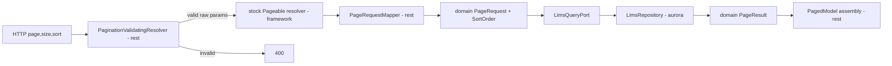

# Design Document

## Overview

Replace the hand-rolled pagination in `/api/v1/lims` with Spring Data's `Pageable` web support
for input and `PagedModel` for output, and add whitelisted `sort`. Pagination stays offset-based.
The hexagonal rule is preserved: `orcanexus-domain` stays plain Java, `orcanexus-rest` is the only
module that takes the Spring Data dependency, and jOOQ stays in `orcanexus-aurora`.

Design principle: **use framework support and configuration over re-implementation.** Where
Spring Boot offers a setting, it is configured under the framework namespace
(`spring.data.web.*`) and any redundant custom `orcanexus.pagination.*` setting is removed.

Out of scope: keyset/cursor pagination, other resources (`fastq`, `bam`, ...). The design is
shaped so those can reuse the pieces later.

## Current State

- `LimsController` takes `Integer page/size`, calls `PaginationRequestFactory.create(...)`,
  and returns `LimsResponse` (flat: `content, page, size, totalElements, totalPages, hasNext,
  hasPrevious`).
- `PaginationRequestFactory` validates and throws `ResponseStatusException(400)`.
- `PaginationProperties` (`orcanexus.pagination`): `default-page`, `default-size`, `max-size`.
- Domain: `PageRequest(page, size)` with `offset()`, `PageResult<T>(content, page, size,
  totalElements)`.
- `LimsRepository` orders by the first column, applies limit/offset, runs a separate count.
- `LimsRecord` columns come from `record.intoMap()`, so response keys are the physical column
  names.
- There is no `@ControllerAdvice` or global error handling today.

## Verified Framework Facts (Spring Boot 4.1.1 / Spring Data Commons 4.1.1)

Established by reading the sources in the local Maven cache; not yet exercised at runtime.

- Boot 4 provides Spring Data web support in the separate module `spring-boot-data-commons`
  (`org.springframework.boot.data.autoconfigure.web.DataWebAutoConfiguration`). It is **not**
  brought in by `spring-boot-starter-webmvc`; it must be added explicitly. It depends on
  `spring-data-commons` (compile scope). Both versions are managed by the Boot BOM.
- Framework properties (`DataWebProperties`, prefix `spring.data.web`):
  `pageable.page-parameter`, `pageable.size-parameter`, `pageable.one-indexed-parameters`,
  `pageable.prefix`, `pageable.qualifier-delimiter`, `pageable.default-page-size` (default 20),
  `pageable.max-page-size` (default 2000), `pageable.serialization-mode`, `sort.sort-parameter`.
  There is no default-page property; the fallback is always page 0.
- `DataWebAutoConfiguration` is conditional (class level) on there being no
  `PageableHandlerMethodArgumentResolver` bean. Declaring our own bean of that type disables the
  whole auto-configuration, including the customizer that applies `spring.data.web.*`.
- The stock resolver is lenient: a negative `page` becomes 0, a non-integer `page` or `size`
  becomes 0, `size < 1` falls back to the default size, and `size` above the max is clamped. The
  customizer exposes setters only, so it cannot make the resolver throw.
- `PagedModel<T>` is a plain generic class exposing `content` (`List<T>`) and `page`
  (`size, number, totalElements, totalPages`). `serialization-mode` only affects a bare `Page`
  return value, so it is not needed when the controller returns `PagedModel` explicitly.

## Architecture



### Module responsibilities

| Module | Change |
|--------|--------|
| `orcanexus-domain` | `PageRequest` gains `List<SortOrder> sort`. New `SortOrder` record and `SortDirection` enum. New `InvalidSortFieldException` (plain Java). |
| `orcanexus-rest` | Add `spring-boot-data-commons`. Controller takes `Pageable`. New validating resolver wrapper, mapper, and `PagedModel` assembly. New exception handler. Remove `LimsResponse`, `PaginationRequestFactory` and `PaginationProperties`. |
| `orcanexus-aurora` | `LimsRepository` builds `ORDER BY` from `SortOrder`s using the table's column names as the whitelist. |
| `orcanexus-application` | Config updates in `application.yaml` / `application-local.yaml`. No new wiring expected. |

## Components and Interfaces

### Domain

- `SortDirection` enum: `ASC`, `DESC`.
- `SortOrder(String field, SortDirection direction)` record; rejects blank field.
- `PageRequest(int page, int size, List<SortOrder> sort)`:
  - Compact constructor keeps the existing page/size checks and defensively copies `sort`
    (`List.copyOf`).
  - A two-argument convenience constructor delegates with an empty sort list so existing callers
    keep compiling.
  - `offset()` unchanged.
- `InvalidSortFieldException extends IllegalArgumentException`: carries the offending field name.
  Thrown by adapters when a requested sort field is not allowed.
- `PageResult` and `LimsQueryPort` signatures are unchanged.

### REST

- **Validating resolver wrapper** (`PaginationValidatingResolver`, a `HandlerMethodArgumentResolver`
  that is *not* a `PageableHandlerMethodArgumentResolver` bean, so Boot's auto-configuration stays
  active):
  - Supports `Pageable` parameters.
  - Reads the page and size parameter names and the maximum page size from the injected
    `DataWebProperties`, so all behaviour follows `spring.data.web.*`.
  - Validates the raw request values and throws `ResponseStatusException(400)` with the existing
    messages (`page must not be negative`, `size must be at least 1`,
    `size must not exceed <max>`); a non-integer value is also a 400.
  - Otherwise delegates to the framework's stock resolver.
  - Registered through a `WebMvcConfigurer`. It must take precedence over the stock resolver;
    the Task 1 spike verifies the ordering.
- `PageRequestMapper` (component): `Pageable` -> domain `PageRequest`, mapping each Spring
  `Sort.Order` to a `SortOrder`.
- `PagedModel` assembly: build a `PageImpl<Map<String,Object>>` from `PageResult` (content,
  `org.springframework.data.domain.PageRequest.of(page, size)`, `totalElements`) and wrap in
  `new PagedModel<>(page)`. `LimsResponse` is removed.
- Exception handler (`@RestControllerAdvice`): maps `InvalidSortFieldException` to HTTP 400 with a
  message naming the field. There is no global handler today, so it is scoped narrowly to this
  exception.

### Aurora

- `LimsRepository` resolves each `SortOrder.field` against the table's fields by exact name
  (case-sensitive match against the physical column name). Unknown names throw
  `InvalidSortFieldException` before any SQL is built. Matched fields become jOOQ `SortField`s;
  the first column ascending is appended as a tiebreaker when it is not already part of the sort.
  With an empty sort list the behaviour is the current first-column ordering.
- Limit, offset and count are unchanged.

## Data Models

Response (`PagedModel`):

```json
{
  "content": [ { "<column>": "<value>" } ],
  "page": { "size": 10, "number": 0, "totalElements": 1234, "totalPages": 124 }
}
```

The response has no `hasNext` or `hasPrevious` fields; they can be derived from `page.number`
and `page.totalPages`.

Sort field names equal the keys in `content` (the physical column names).

## Error Handling

| Condition | Result |
|-----------|--------|
| `page < 0` | 400, `page must not be negative` |
| `size < 1` | 400, `size must be at least 1` |
| `size > spring.data.web.pageable.max-page-size` | 400, `size must not exceed <max>` |
| Non-integer `page`/`size` | 400 |
| Unknown sort field | 400, message names the field |
| Sort direction not `asc`/`desc` | 400 (see note below) |

Note on sort direction: Spring only treats a trailing `asc` or `desc` (case-insensitive) as a
direction. Any other trailing token, such as `sort=library_id,sideways`, is parsed as another
property name, so it reaches the whitelist and is rejected as an unknown sort field. No separate
direction validation is needed.

All 400s are rendered as RFC 9457 problem details (status 400, `detail` carrying the message).
`spring.mvc.problemdetails.enabled=true` is set in `application.yaml`; this makes Boot register a
`ResponseEntityExceptionHandler` that renders the validating resolver's `ResponseStatusException`s.
Sort errors use a narrowly scoped `@RestControllerAdvice` returning a `ProblemDetail` naming the
field. The setting applies to every MVC error response in the application, not only pagination.

## Configuration

All pagination settings move to the framework namespace; the `orcanexus.pagination.*` block is
removed from `application.yaml` and `application-local.yaml`.

| Previous | Replacement |
|----------|-------------|
| `orcanexus.pagination.default-size` | `spring.data.web.pageable.default-page-size` |
| `orcanexus.pagination.max-size` | `spring.data.web.pageable.max-page-size` |
| `orcanexus.pagination.default-page` | removed (framework fallback is always page 0) |

Values stay env-overridable (`${ENV_VAR:default}`) per the Spring conventions. No concrete schema
names are introduced in code or comments.

## Testing Strategy

- Domain unit tests: `PageRequest` (sort copy, validation), `SortOrder`.
- REST unit tests: the validating resolver wrapper and `PageRequestMapper`.
- REST MockMvc tests: envelope shape, defaults, each 400 case, sort parameters, unknown sort
  field, using a stubbed use case.
- Aurora: tests of the ordering logic that do not need a live database (for example rendering
  the generated SQL from a `DSLContext` with no connection). Live-DB behaviour is verified only
  if the tunnel and AWS session are available.
- Build gate: `mvn -DskipTests compile` after each task, `mvn verify` at the end.

## Risks and Decisions

Resolved during design review:

1. **Boot 4.1.1 auto-configuration and property names** - verified from sources (see Verified
   Framework Facts). Framework namespace `spring.data.web.*` is used; redundant custom
   properties are folded away.
2. **Resolver leniency vs. required 400** - the customizer cannot make the resolver throw.
   Decision: validating wrapper that checks raw params then delegates to the stock resolver
   (adjusted approach A), keeping the auto-configuration active.
3. **`PagedModel` with `Map` content** - plain generic class; no special serialization needed
   when returned explicitly. Confirmed at runtime by the Task 1 MockMvc test.
4. **Sort names are physical column names** - accepted, no alias layer. Sort names match response
   keys, so a schema change is already a visible API change. Consistent with the database-first
   stance.
5. **Sorting on non-indexed columns may be slow on large tables** - accepted; indexes will be
   created in the database as needed. No mitigation in this change.

Confirmed by the Task 1 spike (MockMvc runtime tests):

- `PagedModel` with `Map` content serializes as `content` plus `page{size, number,
  totalElements, totalPages}`; no `serialization-mode` setting is needed.
- `spring.data.web.pageable.default-page-size` is applied by the framework to the `Pageable`
  argument.
- Generated column names in the jOOQ `Lims` table are plain lowercase snake_case identifiers, so
  exact-match sort names work as expected.
- Springdoc 3.1.1 renders `Pageable` as a single `pageable` object parameter unless the argument
  is annotated with `@ParameterObject`. With it, `page`, `size` and `sort` are documented as
  separate query parameters. Controllers taking `Pageable` must use `@ParameterObject`
  (`org.springdoc.core.annotations.ParameterObject`). Any wrapper resolver must keep the
  controller signature as `@ParameterObject Pageable`.

Confirmed by Task 2:

- The validating wrapper takes precedence over the stock resolver: `@Order(HIGHEST_PRECEDENCE)`
  on the `WebMvcConfigurer` that registers it is sufficient. MockMvc tests show invalid values
  produce 400 and an oversized `size` is rejected rather than clamped.
- The stock resolver is looked up lazily (`ObjectProvider`) from the wrapper, avoiding a circular
  dependency with Spring Data's own `WebMvcConfigurer`.
- Under `@WebMvcTest`, plain `@Component`s are filtered out, so slice tests must `@Import`
  `PageRequestMapper` and `PaginationWebConfiguration`. The full application scans them normally.
- Parameter qualifiers (`@Qualifier` on `Pageable`) are not supported by the wrapper; only the
  configured prefix plus parameter name is validated.
