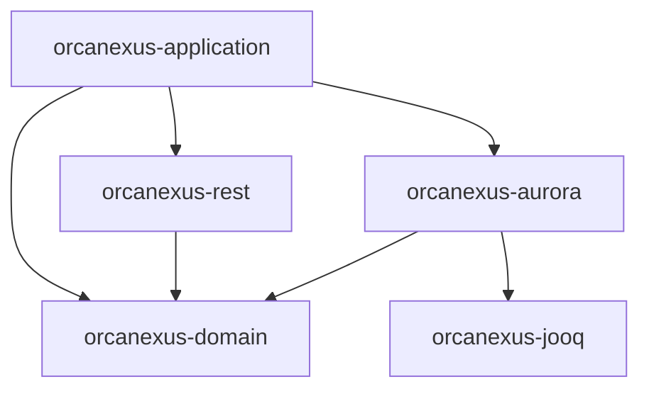

# Architecture & Module Structure

OrcaNexus follows **hexagonal (ports & adapters)** architecture across five Maven
modules. The dependency rule is the invariant to protect: **everything points
inward toward the domain; the domain depends on nothing.**

> **Key architectural principle:** The API exposes use cases; the domain defines
> ports; each storage technology implements its own adapter; the application service
> governs routing.

## Modules and allowed dependencies

| Module                  | Role                                                    | May depend on                          |
|-------------------------|---------------------------------------------------------|----------------------------------------|
| `orcanexus-domain`      | Core: use cases, ports, domain models                   | nothing internal (no Spring, no infra) |
| `orcanexus-rest`        | Inbound (driving) adapter: REST controllers, DTOs       | `orcanexus-domain`                     |
| `orcanexus-aurora`      | Outbound (driven) adapter: jOOQ repositories, DB config | `orcanexus-domain`, `orcanexus-jooq`   |
| `orcanexus-jooq`        | Infrastructure leaf: generated jOOQ model               | nothing internal                       |
| `orcanexus-application` | Composition root: `main`, Spring wiring                 | all of the above                       |

### Module dependency graph



Arrows point from dependent to dependency. All arrows ultimately point inward to
`orcanexus-domain`, which has no internal dependencies.

### Hard rules
- **Never** add a dependency that makes `orcanexus-domain` depend on another module
  or on Spring/jOOQ/infrastructure. Keep it plain Java.
- `orcanexus-rest` must not depend on `orcanexus-aurora` or `orcanexus-jooq`
  directly — it talks to the domain through ports only.
- Infrastructure types (`org.jooq.*`, DB concerns) live in `orcanexus-aurora`, not
  in `rest` or `domain`.
- `orcanexus-application` is the only module that wires adapters together.

## Reference flow (LIMS vertical slice)

```
LimsController (rest)                      inbound adapter
  └─► FindLimsRecordsUseCase (domain port)
        └─ FindLimsRecordsService (domain)  application/use-case logic
              └─► LimsQueryPort (domain port)
                    └─ LimsRepository (aurora)  outbound adapter (jOOQ)
                          └─► jOOQ generated model (jooq) ─► Aurora
```

Use this slice as the template when adding a new resource: controller + DTO in
`rest`, a use-case interface + service + port + model in `domain`, and a jOOQ-backed
repository implementing the port in `aurora`.

## Package layout

Base package `dev.ccgcm.platform.orcanexus`, sub-packaged per module:
- `...domain.{model,port,service}`
- `...rest.{controller,response,config}`
- `...aurora.{repository,config}`
- `...jooq` (generated; do not hand-edit)
- application root holds `OrcaNexusApplication` + `config`.

## Domain purity

- Domain services are **plain Java** (e.g. `final class ... implements <UseCase>`),
  wired as beans in the application layer (`DomainConfiguration`), not annotated with
  Spring stereotypes. Keep framework annotations out of `orcanexus-domain`.
- Ports are interfaces in `orcanexus-domain`; adapters implement them.
