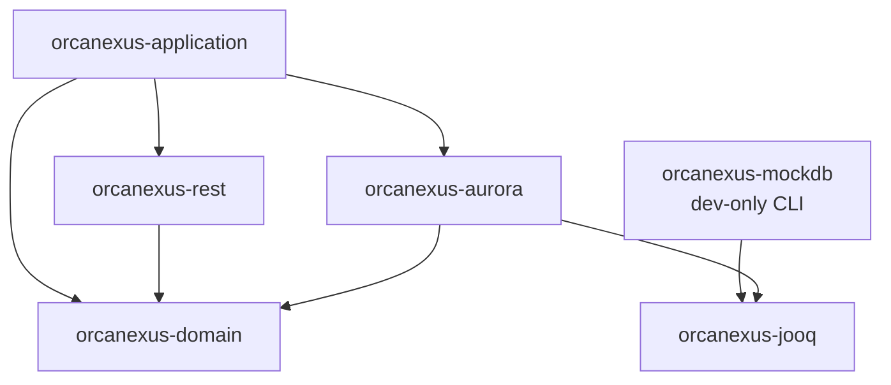

# Architecture overview

OrcaNexus is the Warehouse Data API for UMCCR: a read-oriented REST service over curated
Aurora PostgreSQL warehouse content (`lims`, `fastq`, `bam`, `vcf`, `workflow`,
`workflow_output`, `workflow_cost_report`). It is a data-serving tier, not the system of
record: the upstream warehouse owns data production, and OrcaNexus exposes it. Favour query
clarity and correctness over write and transactional concerns.

## Stack

- Java 21 (Amazon Corretto), enforced by maven-enforcer (`[21,22)`)
  ([ADR 0003](../decisions/0003-spring-boot-and-java-21.md)).
- Maven multi-module, parent `dev.ccgcm.platform:orcanexus`, inheriting
  `spring-boot-starter-parent` (Web MVC, Actuator, Validation). The parent `pom.xml` holds the
  versions.
- jOOQ over Aurora PostgreSQL. The runtime version is managed by Spring Boot; the codegen
  plugin version is pinned to match.
- DB connectivity: AWS Advanced JDBC Wrapper with IAM auth (`software.amazon.jdbc.Driver`).
- API docs: springdoc-openapi (Swagger UI).

## Hexagonal modules

Six Maven modules: five form the hexagon and one is a dev-only tool. Everything points inward;
the domain depends on nothing ([ADR 0002](../decisions/0002-hexagonal-architecture.md)).

| Module                  | Role                                                    | May depend on                          |
|-------------------------|---------------------------------------------------------|----------------------------------------|
| `orcanexus-domain`      | Core: use cases, ports, domain models                   | nothing internal (no Spring, no infra) |
| `orcanexus-rest`        | Inbound adapter: REST controllers, DTOs                 | `orcanexus-domain`                     |
| `orcanexus-aurora`      | Outbound adapter: jOOQ repositories, DB config          | `orcanexus-domain`, `orcanexus-jooq`   |
| `orcanexus-jooq`        | Generated jOOQ model                                    | nothing internal                       |
| `orcanexus-application` | Composition root: `main`, Spring wiring                 | the four modules above                 |
| `orcanexus-mockdb`      | Dev-only CLI: schema and synthetic data for the offline path | `orcanexus-jooq`                  |

No runtime module depends on `orcanexus-mockdb`. It is a dev-only path
([offline mock database](../dev/offline-mockdb.md)).



Arrows point from dependent to dependency.

### Dependency rules

- `orcanexus-domain` stays plain Java: no dependency on another module, Spring, jOOQ or
  infrastructure. Domain services are `final class ... implements <UseCase>`, wired as beans in
  `DomainConfiguration`, with no Spring stereotypes. Ports are domain interfaces; adapters
  implement them.
- `orcanexus-rest` talks to the domain through ports only; it must not depend on
  `orcanexus-aurora` or `orcanexus-jooq`.
- Infrastructure types (`org.jooq.*`, DB concerns) live in `orcanexus-aurora`, not in `rest`
  or `domain`.
- `orcanexus-application` is the only module that wires adapters together.
- `orcanexus-mockdb` is a leaf outside the hexagon: it depends only on `orcanexus-jooq`, the
  Postgres driver and Datafaker. No module depends on it, it is not in the application jar, and
  it never connects to a non-localhost host.

## Request flow (LIMS slice)

```
LimsController (rest)                      inbound adapter
  └─► FindLimsRecordsUseCase (domain port)
        └─ FindLimsRecordsService (domain)  use-case logic
              └─► LimsQueryPort (domain port)
                    └─ LimsRepository (aurora)  outbound adapter (jOOQ)
                          └─► jOOQ generated model (jooq) ─► Aurora
```

This slice is the template for new resources: see [adding a resource](../dev/adding-a-resource.md).

## Package layout

Base package `dev.ccgcm.platform.orcanexus`:

- `...domain.{model,port,service}`
- `...rest.{controller,response,config}`
- `...aurora.{repository,config}`
- `...jooq` (generated, do not hand-edit)
- application root: `OrcaNexusApplication` and `config`

Domain services are plain Java, wired as beans in `DomainConfiguration`.

## Concepts

- **Database-first with jOOQ, no ORM.** jOOQ introspects the database schema and generates the
  Java model. Modeling happens in the database and drives the Java application
  ([ADR 0004](../decisions/0004-database-first-jooq-no-orm.md)).
- **Remote dev database (`tunnel`).** Developers can reach the dev database through an SSM
  tunnel to a small EC2 instance in a private subnet, using IAM database auth with 15-minute
  tokens and a read-only user. No static passwords. AWS VPN may follow at about 10 developers
  ([ADR 0005](../decisions/0005-remote-only-dev-with-iam-auth.md)).
- **Local mock database (`mockdb`).** A local PostgreSQL in Docker Compose with synthetic data, selected
  by the `mockdb` profile, for work without AWS access. The default profile is `tunnel`. See
  [offline mock database](../dev/offline-mockdb.md) and
  [ADR 0010](../decisions/0010-local-mock-database.md).
- **Pagination and errors** follow shared conventions: see [api/README.md](../api/README.md).

## Decisions

See the [ADR index](../decisions/README.md).
