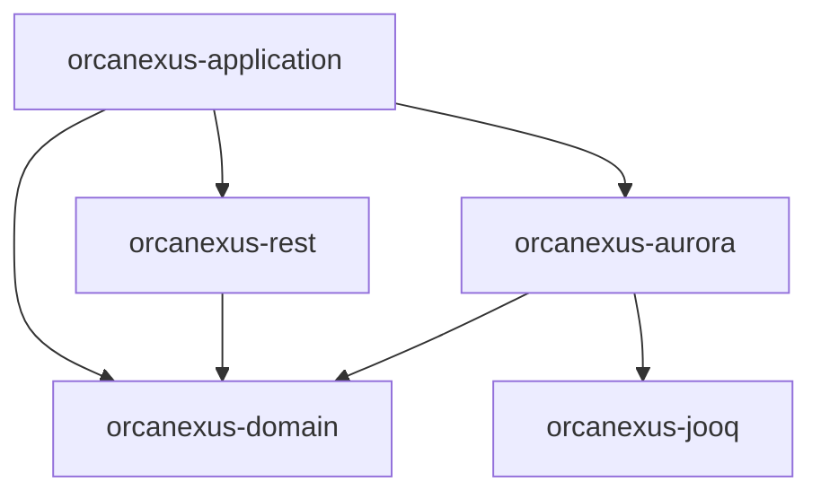

# Architecture overview

OrcaNexus is the Warehouse Data API for UMCCR: a read-oriented REST service over curated
Aurora PostgreSQL warehouse content (`lims`, `fastq`, `bam`, `vcf`, `workflow`,
`workflow_output`, `workflow_cost_report`). It is a data-serving tier, not the system of
record.

## Hexagonal modules

Five Maven modules. Everything points inward; the domain depends on nothing
([ADR 0002](../adr/0002-hexagonal-architecture.md)).

| Module                  | Role                                                    | May depend on                          |
|-------------------------|---------------------------------------------------------|----------------------------------------|
| `orcanexus-domain`      | Core: use cases, ports, domain models                   | nothing internal (no Spring, no infra) |
| `orcanexus-rest`        | Inbound adapter: REST controllers, DTOs                 | `orcanexus-domain`                     |
| `orcanexus-aurora`      | Outbound adapter: jOOQ repositories, DB config          | `orcanexus-domain`, `orcanexus-jooq`   |
| `orcanexus-jooq`        | Generated jOOQ model                                    | nothing internal                       |
| `orcanexus-application` | Composition root: `main`, Spring wiring                 | all of the above                       |



Arrows point from dependent to dependency.

## Request flow (LIMS slice)

```
LimsController (rest)                      inbound adapter
  └─► FindLimsRecordsUseCase (domain port)
        └─ FindLimsRecordsService (domain)  use-case logic
              └─► LimsQueryPort (domain port)
                    └─ LimsRepository (aurora)  outbound adapter (jOOQ)
                          └─► jOOQ generated model (jooq) ─► Aurora
```

This slice is the template for new resources: see [adding a resource](../dev/adding-a-resource.md).

## Package layout

Base package `dev.ccgcm.platform.orcanexus`:

- `...domain.{model,port,service}`
- `...rest.{controller,response,config}`
- `...aurora.{repository,config}`
- `...jooq` (generated, do not hand-edit)
- application root: `OrcaNexusApplication` and `config`

Domain services are plain Java, wired as beans in `DomainConfiguration`.

## Concepts

- **Database-first with jOOQ, no ORM.** jOOQ introspects the database schema and generates the
  Java model. Modeling happens in the database and drives the Java application
  ([ADR 0004](../adr/0004-database-first-jooq-no-orm.md)).
- **Remote-dev.** There is no local database. Developers reach the dev database through an SSM
  tunnel to a small EC2 instance in a private subnet, using IAM database auth with 15-minute
  tokens and a read-only user. No static passwords. AWS VPN may follow at about 10 developers
  ([ADR 0005](../adr/0005-remote-only-dev-with-iam-auth.md)).
- **Pagination and errors** follow shared conventions: see [api/conventions.md](../api/conventions.md).

## Decisions

See the [ADR index](../adr/README.md).
